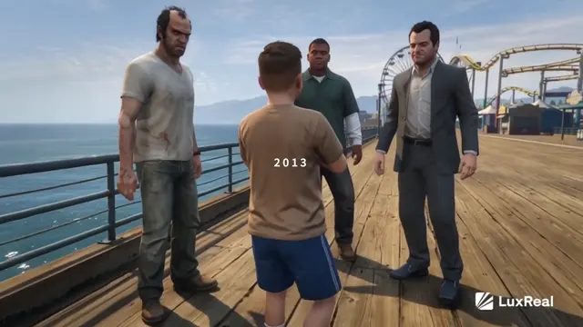
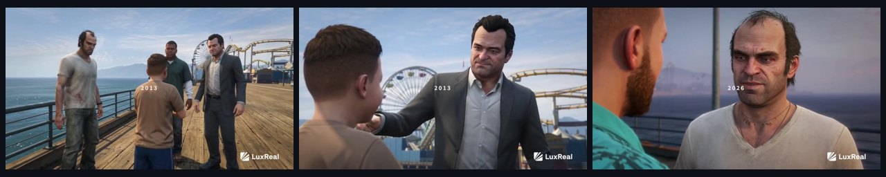

<p align="center">
  <a href="https://www.luxreal.ai/features/drama-agent?utm_source=GitHub&amp;utm_medium=website&amp;utm_campaign=GTA&amp;utm_content=readme_logo_zh">
    <picture>
      <source media="(prefers-color-scheme: dark)" srcset="./assets/luxreal-logo-dark.png">
      
    </picture>
  </a>
</p>

<h1 align="center">GTA 风格开放世界短剧 Skill</h1>
<p align="center">一句设定，生成 10 个连续任务。角色和道具沿用，每幕附生图词、视频词、旁白和对白。</p>
<h3 align="center"><a href="https://www.luxreal.ai/features/drama-agent?utm_source=GitHub&amp;utm_medium=website&amp;utm_campaign=GTA&amp;utm_content=readme_primary_zh">在 LuxReal 做第一镜 →</a></h3>
<p align="center"><a href="./README.md">English</a> · <a href="#安装与使用">安装 Skill</a></p>

## 成片预览

动图直接预览。点击动图可播放 30 秒完整视频（带声音）。

[](https://cdn.jsdelivr.net/gh/YvonneMovingon/gta-style-short-drama-skill@main/assets/gta-style-demo.mp4)

**[用我的设定做第一镜 →](https://www.luxreal.ai/features/drama-agent?utm_source=GitHub&utm_medium=website&utm_campaign=GTA&utm_content=after_demo_zh)** · [播放完整视频](https://cdn.jsdelivr.net/gh/YvonneMovingon/gta-style-short-drama-skill@main/assets/gta-style-demo.mp4) · [下载 MP4](./assets/gta-style-demo.mp4)



## 现在就做第一镜

复制下方《午夜接力》的第一幕简报，打开 LuxReal 短剧 Agent 粘贴，检查角色、机位与道具后开始生成。

> 16:9, 12-second original micro-drama, set at a rainy harbor after dusk. Ren is a night courier in their early 30s with short black curls, warm brown skin, a mustard rain jacket, dark trousers and a slate crossbody bag. The delivery van is weathered white with one teal stripe. Start over Ren's right shoulder beside the van's rear wheel, with a dispatch locker on the right. Ren opens the locker and lifts a transparent cassette with one orange tab. A nearby sign glows through the rain. End on the orange tab against Ren's mustard sleeve. Ren says, “An actual tape?” Use the cassette in the next scene at the shuttered radio station.

**[打开 LuxReal 短剧 Agent →](https://www.luxreal.ai/features/drama-agent?utm_source=GitHub&utm_medium=website&utm_campaign=GTA&utm_content=first_shot_zh)**

## 安装包内容预览

《午夜接力》讲的是夜班送货员送出一盘录音带，让停播电台重新发声。角色设定和每幕的提示词都可以直接复制。

### 角色与资产

- **C01 Ren**　夜班送货员。黑色短卷发、芥末黄雨衣、深色斜挎包。
- **C02 Sol**　前电台维修员。银色短发、蓝绿色工作衫、圆框眼镜。
- **P01 / V01 / W01**　带橙色标签的透明录音带、蓝绿色条纹白色货车，以及沿海港城 Tern Harbor。

### 十幕故事与完整提示词

| 任务 | 剧情进展 |
|---|---|
| M01 · 最后一单 | 送货员取出一盘录音带，地址指向停播电台。 |
| M02 · 电台停播 | 电台上锁，便签指向隔壁修理店。 |
| M03 · 寻找维修员 | 找到前电台维修员 Sol。他认出自己的橙色标签，想听一听录音。 |
| M04 · 录音里的线索 | 听见录音留下的线索，去渡口取现场录音机。 |
| M05 · 渡口仓库 | 拿到现场录音机，Sol 接过录音带和接收设备，两人前往灯塔。 |
| M06 · 道路封闭 | 车道封闭，改走通往灯塔的步桥。 |
| M07 · 横风中的步桥 | 带着设备过桥，继续向灯塔前进。 |
| M08 · 灯塔播音间 | 进入灯塔，找到仍能使用的播音设备。 |
| M09 · 最后一次广播 | 电台旧开场响起，随后的录音陪港口度过风暴。 |
| M10 · 天亮之后 | 广播留在港口，送货任务随天亮收尾。 |

展开任一幕，即可看到开场画面提示词、视频提示词、旁白、对白与下一幕衔接。

<details>
<summary>M01 · 最后一单</summary>

**Objective and handoff:** Pick up the final item. The station address sends Ren straight to a building no longer on air.

**Image prompt:** Wide 16:9 third-person frame behind the right shoulder of Ren, a warm-brown-skinned courier with short black curls, mustard rain jacket, dark trousers and a slate bag. A rain-spotted white van with one teal stripe stands to the left. The closed blue dispatch locker is on the right at arm's length. Sodium light shimmers across shallow puddles.

**Video prompt:** Start in the same wide over-right-shoulder view, mustard-jacket courier with short black curls and slate bag between the striped white van on the left and closed locker on the right. 0–3s: Ren lifts the spring-latch cover. 3–8s: the locker opens and Ren removes one clear cassette with an orange tab; rain patters on the van roof. 8–12s: the lens moves to the tab framed against the mustard sleeve.

**Narration (0–2s):** One more delivery.

**Dialogue (Ren, 8–10s):** “An actual tape?”

**Continuity out:** Ren has the intact tape and the destination.

</details>

<details>
<summary>M02 · 电台停播</summary>

**Objective and handoff:** Deliver the tape at the station. The shutter is locked, and a note points Ren to the next-door repair shop.

**Image prompt:** Wide 16:9 view over the left shoulder of Ren, short black curls, warm brown skin, mustard rain jacket, slate bag and dark trousers. Ren stands a step from a closed steel station shutter, cassette with orange tab held in the left hand. A torn paper notice hangs from the shutter, a lit repair shop to frame right.

**Video prompt:** Start with the same locked silver shutter, the repair shop right, and the curly-haired courier's mustard shoulder left, orange-tab tape in Ren's left hand. 0–4s: Ren knocks twice; only the rain answers. 4–8s: they lift the torn notice, revealing a hand-painted arrow toward the repair shop. 8–12s: look right and start walking; the shop's warmth colors their face.

**Narration (0–2s):** The address was right.

**Dialogue (Ren, 7–9s):** “The station's closed.”

**Continuity out:** Tape stays with Ren. The shop is one doorway away.

</details>

<details>
<summary>M03 · 寻找维修员</summary>

**Objective and handoff:** Find someone who recognizes the tape. Sol recognizes their own orange label and asks to hear it.

**Image prompt:** 16:9 two-shot from inside a cluttered radio repair shop, rainy doorway behind Ren. Ren stands on the left, warm brown skin, short black curls, wet mustard jacket, dark trousers and slate bag. At right, Sol has cropped silver hair, olive skin, round glasses, teal shirt and white T-shirt. One clear cassette with orange tab sits in Ren's open left palm. A dead green oscilloscope and a working amber desk lamp sit between them.

**Video prompt:** Begin in the same two-shot, curly-haired Ren left in the mustard jacket, silver-haired Sol right in teal and round glasses. Ren's open palm holds the orange-tab cassette at desk height. 0–4s: Sol sets down a pen and leans toward the label. 4–9s: Sol points toward a small deck deeper in the shop; hold on their face for the line. 9–12s: Ren closes their hand around the tape. Ambient rain fades behind transformer hum.

**Narration:** No narration; leave room for the reaction.

**Dialogue (Sol, 5–8s):** “That's my label. Put it in the deck.”

**Continuity out:** Ren still holds the tape, knows Sol can identify the recording.

</details>

<details>
<summary>M04 · 录音里的线索</summary>

**Objective and handoff:** Test the tape. The old harbor announcement refers to an emergency field recorder kept at the ferry shed.

**Image prompt:** Tight 16:9 three-quarter view of the service bench. Ren, warm brown skin and mustard jacket, holds the transparent orange-tab cassette just outside a tabletop tape deck. Sol with silver crop, round glasses, olive skin and teal over white stands behind the deck. A little analog speaker is beside Sol at frame right; rain slips down the distant frosted glass.

**Video prompt:** Start with the same tabletop composition, Ren's mustard sleeve and the clear orange-tab tape in front of the deck, Sol in teal visible over the speaker. 0–3s: Ren inserts the tape and hits Play. 3–8s: a soft crackle, then a recorded location clue. Sol traces a finger toward a ferry icon on a wall map. 8–12s: Ren ejects and pockets the tape; cut on the click.

**Narration:** No narration.

**Dialogue (recorded harbor announcer, 4–7s):** “Backup recorder: the old ferry shed.”

**Continuity out:** The tape returns to Ren's bag. They head for the shed.

</details>

<details>
<summary>M05 · 渡口仓库</summary>

**Objective and handoff:** Collect the field recorder. Sol takes the tape and receiver kit, and both head for the lighthouse studio.

**Image prompt:** Medium 16:9 framing at a ferry shed shelf. Ren, short black curls, warm brown skin, mustard rain jacket and slate bag, is left with a clear orange-tab cassette in hand. Sol, cropped silver hair, olive skin, round glasses, teal shirt over white, is on the right reaching toward a metal field recorder tucked beside a life ring. Rain is visible through the open door.

**Video prompt:** Match the still at second zero: mustard-jacket Ren left with orange-tab tape, silver-haired Sol right beside the metal recorder and life ring. 0–4s: Sol lifts the recorder. 4–8s: Ren hands the cassette over and Sol slips it into the recorder case's exterior sleeve. 8–12s: both turn toward the shed door under a single swinging bulb.

**Narration (0–2s):** Now they just needed a signal.

**Dialogue (Sol, 8–10s):** “The lighthouse studio.”

**Continuity out:** Sol carries the closed kit and visible cassette sleeve.

</details>

<details>
<summary>M06 · 道路封闭</summary>

**Objective and handoff:** Drive to the lighthouse. A closed service road forces them onto the footbridge.

**Image prompt:** 16:9 third-person chase view behind a weathered white van with a single teal stripe, waiting several metres short of a closed storm barrier. Wind drives rain across the headlight beams. Under the roadside lamp, a smaller sign indicates the footbridge to the left. No one is yet outside the van.

**Video prompt:** Begin in the same rear chase view, white van with one teal stripe stopped in the cone of the barrier lamps. 0–4s: the indicator blinks, tires splash as the van pulls into the lay-by. 4–8s: short motivated cut to the side door as Ren in the mustard jacket steps out; Sol, silver hair, round glasses and teal shirt, follows carrying the metal kit with orange-tab cassette in its exterior sleeve. 8–12s: the two look toward the footbridge sign. The van stays parked.

**Narration (0–3s):** The road was gone.

**Dialogue (Ren, 9–11s):** “We can walk it.”

**Continuity out:** Both walk; Sol retains the kit and cassette.

</details>

<details>
<summary>M07 · 横风中的步桥</summary>

**Objective and handoff:** Cross the footbridge. The lighthouse lamp reveals the studio door as they reach the far shore.

**Image prompt:** 16:9 over-the-shoulder view at the near landing behind Ren, curly hair, mustard jacket and slate bag, with Sol's cropped silver hair, teal shirt and metal kit one step ahead. The orange tape tab shows through the kit sleeve. Wind ripples bridge flags, and the lighthouse lamp makes a pale line across the far end.

**Video prompt:** Start over Ren's mustard shoulder at the near landing, Sol facing away in teal with the metal kit and orange tab visible. 0–5s: camera follows their first steps, rain running along the rails. 5–9s: they pause as the sweeping lighthouse light catches the studio entrance across the landing. 9–12s: Sol nods toward that light and starts moving again.

**Narration:** No narration; keep bridge footsteps and weather clear.

**Dialogue (Sol, 9–11s):** “That door. We're close.”

**Continuity out:** The two arrive at the far-side studio entrance with the kit.

</details>

<details>
<summary>M08 · 灯塔播音间</summary>

**Objective and handoff:** Enter the elevated studio. Its on-air lamp is dark, but the desk wakes and the tape can be loaded.

**Image prompt:** 16:9 wide interior view facing the old lighthouse broadcast desk. Ren with warm brown skin, short black curls, mustard jacket and slate bag is beside the entrance left. Sol, olive skin, cropped silver hair, round glasses and teal over white, stands right holding the metal recorder kit with the orange cassette tab visible. The dark on-air lamp hangs above a dusty console.

**Video prompt:** Open in the same wide studio view, Ren in mustard left, silver-haired Sol in teal right with the kit, lamp dark. 0–4s: Sol sets the kit beside the console. 4–8s: desk meters rise as the lamp room's lights return; Ren leans toward the glass. 8–12s: Sol opens the case and takes the only orange-tab cassette from the exterior sleeve.

**Narration (0–2s):** The studio still had power.

**Dialogue (Sol, 8–10s):** “We can play it.”

**Continuity out:** Tape is in Sol's hands, console active, still off air.

</details>

<details>
<summary>M09 · 最后一次广播</summary>

**Objective and handoff:** Play the tape. The old station signature comes through, followed by a promise to keep the harbor company through the storm.

**Image prompt:** Three-quarter close shot in 16:9 of Sol's hands at the recorder, with silver crop, round glasses and teal sleeve visible. The clear orange-tab cassette is in Sol's right hand next to the open deck. Ren in a wet mustard jacket listens from behind glass on the left. The small ON AIR lamp is dark and rain streaks the far window.

**Video prompt:** Start in the same close composition, cassette immediately above the open deck, Sol's teal sleeve right and Ren's mustard figure behind glass left. 0–4s: Sol loads the cassette once and presses Play. 4–7s: the red on-air lamp comes on. 7–12s: hold on Ren as the station motif gives way to the recorded voice. The storm stays audible behind the tape.

**Narration:** No additional narration.

**Dialogue (tape, 7–11s):** “Tern Harbor, if you're listening, we're still here.”

**Continuity out:** Tape is playing in the studio deck as the harbor hears it.

</details>

<details>
<summary>M10 · 天亮之后</summary>

**Objective and handoff:** See who heard the broadcast. The morning lights and two radios answer the first scene's impossible delivery.

**Image prompt:** 16:9 wide view from the lighthouse landing at early dawn. Ren, short black curls, warm brown skin, mustard rain jacket and slate bag, stands left against the rail. Sol, silver crop, olive skin, teal over white and round glasses, stands right. The studio lamp glows behind them; below, the harbor stalls are unlit, wet roofs reflecting pale sky.

**Video prompt:** Begin at the same landing with Ren left and Sol right at the rail, studio lamp glowing behind them. 0–5s: a vendor switches on one stall light below, then a second stall lights up. 5–9s: drift back toward the pair as the station motif plays faintly from two radios down on the waterfront. 9–12s: Ren drops the bag against the rail and smiles, sunrise passing across the mustard shoulder.

**Narration (9–12s):** The last delivery came through.

**Dialogue:** No on-screen dialogue.

**Continuity out:** The delivery is complete, the original tape remains in the station deck, and the story closes at dawn.

</details>

每幕的输出字段是任务与衔接、开场生图词、视频词、旁白与对白、承接下一幕的状态。

<details>
<summary>展开查看交付模板</summary>

## Series header

- Title, logline, selected format and timing, and a short synopsis including the ending.
- Canonical cast and asset bible. Give each recurring asset an ID and a portable text descriptor. Establish visual geography, recurring wardrobe, object ownership, voice, and optional overlay layout.
- One-line cause-and-effect spine from M01 through M10. Assets may change only at an explicit event. Record that event and carry the changed state forward.

## Each mission

Label each mission with its ID and a distinct title.

1. **Objective and handoff.** State what happened immediately before, what the characters want here, and what visible outcome sets up the next mission. Resolve the central question on the last mission.
2. **Opening image prompt.** Specify the frame at second zero. Include aspect ratio, shot size, camera orientation, composition, scene lighting, visible character descriptions and poses, and the current location and state of key objects. Describe visual texture using concrete details such as reflected wet neon, humid air, and third-person camera height. Leave out overlays if they compete with the frame. If enabled, reserve a consistent area for a custom overlay and composite precise labels in editing.
3. **Video prompt.** Restate the opening composition and visible asset descriptions, then describe the moves in order with approximate timings, focused character reactions, scene audio, camera behavior, and the final frame. Keep still and video inputs usable without referring to previous text. A cut between missions can bridge a location change; the reason for the move belongs in the handoff.
4. **Narration and character dialogue.** Put narration and on-screen dialogue in separate fields, with speaker IDs and approximate time slots. Keep speech short enough to fit. Narration may be added in post. If dialogue has no useful role, state “No on-screen dialogue” and leave that time for visual action or ambient audio. Exact speech and on-screen text can be added during editing if the chosen generator does not reproduce them reliably.
5. **Continuity out.** Give the viewer a visible answer or question and record any object, time, wardrobe, or location changes that the next scene must honor.

## Paste-ready first-scene brief

Give a short block containing the premise, relevant cast descriptions, format, three visual beats, opening composition, final frame, and dialogue where present. Use the opening, action, and final frame already established for M01. The user can paste the brief into LuxReal and check its storyboard before spending time rendering. If a change is needed, correct the bible or the one affected shot and recheck the downstream handoff.

</details>

## 安装与使用

```bash
npx skills add YvonneMovingon/gta-style-short-drama-skill --skill open-world-short-drama
```

给 Agent 一句故事设定，或先让它只做第一幕。也可直接打开安装包的 Skill 指令与文件。

[Skill 指令](./skills/open-world-short-drama/SKILL.md) · [完整示例原文](./skills/open-world-short-drama/references/example-midnight-relay.md) · [交付模板原文](./skills/open-world-short-drama/references/delivery-format.md)

<h3 align="center"><a href="https://www.luxreal.ai/features/drama-agent?utm_source=GitHub&amp;utm_medium=website&amp;utm_campaign=GTA&amp;utm_content=readme_footer_zh">把你的设定变成第一个镜头 · 在 LuxReal 开始创作 →</a></h3>

Skill 与文本示例采用 [MIT License](./LICENSE)。视频与截图供预览，LuxReal Logo 用于产品入口。
